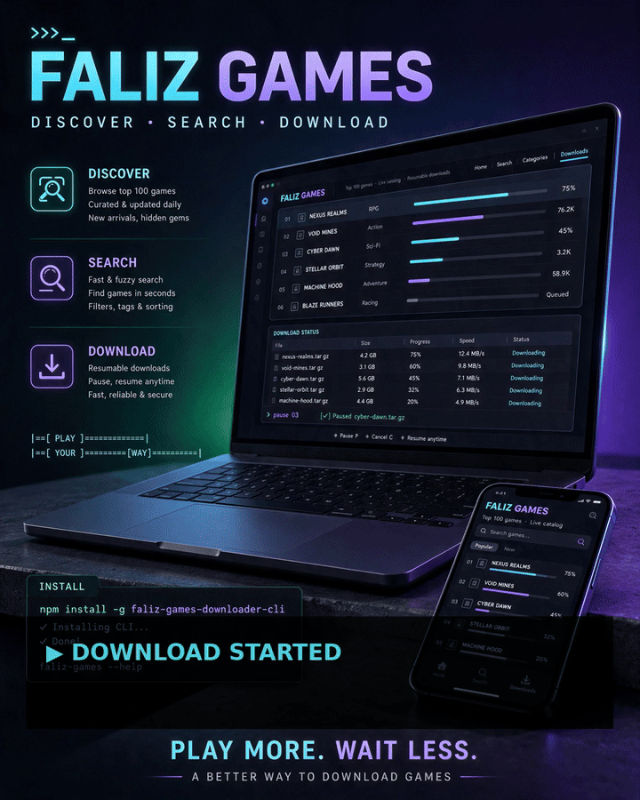

<div align="center">
  <a href="https://github.com/gamesiteonline/faliz-games-downloader-cli">
    
  </a>

  <br>
  <br>

  <a href="https://github.com/gamesiteonline/faliz-games-downloader-cli">
    
  </a>
  <a href="https://nodejs.org/">
    
  </a>
  <a href="https://www.npmjs.com/">
    
  </a>

  <h1>Faliz Games Downloader CLI</h1>
  <p><strong>Discover. Search. Download. Resume anytime.</strong></p>
  <p>A fast, professional terminal dashboard for browsing a live game catalog and downloading authorized files.</p>
</div>

<div align="center">
  
</div>

> [!IMPORTANT]
> Faliz Games is a catalog and file-transfer tool. Download, install, and use only content you are legally authorized to access.

## ░▒▓ Dashboard overview

The launcher opens with a dark blue-and-violet game-library dashboard inspired by modern PC game clients: a left navigation rail, catalog pulse summary, recently played and featured cards, Top-rated progress rows, and a compact keyboard control bar. The dashboard remains text-first and responsive for narrow Android Termux screens.

<table>
<tr>
<td width="33%" valign="top">

### ◈ Discover

- Live catalog synchronization
- Featured, trending, and latest discovery views with honest metadata fallback
- Top 100 highest-rated games
- Offline cache fallback
- Genre and platform browsing
- Favorites, wishlist, recently viewed, download history, and local library metadata
- Refresh on demand

</td>
<td width="33%" valign="top">

### ◈ Control

- Search by title, genre, platform, or extension
- Filter and sort results
- Select multiple games with Space
- Back navigation and queue actions

</td>
<td width="33%" valign="top">

### ◈ Download

- Visible start feedback
- Live speed and ETA
- `P` pause/resume
- `C` cancel and resume later
- Configurable retry/backoff, request timeout, SHA-256 verification, and disk-space preflight

</td>
</tr>
</table>

## ▰ Feature matrix

| System | Capability | Status |
|---|---|:---:|
| Catalog | Live sync with ETag / Last-Modified support | `LIVE` |
| Ranking | Top 100 rated games | `READY` |
| Search | Title, platform, genre, extension | `READY` |
| Filters | Platform and extension filters | `READY` |
| Sorting | Rating, title, and size sorting | `READY` |
| Queue | Multiple game selection and sequential downloads | `READY` |
| Transfer | Streamed downloads without buffering entire files | `FAST` |
| Recovery | Partial-file resume when the server supports byte ranges | `RESUMABLE` |
| Controls | Pause, resume, cancel, and `Ctrl+C` interruption | `ACTIVE` |
| Storage | Downloads folder support for desktop and Termux | `MOBILE READY` |
| Discovery | Featured, trending/latest fallback, genre and platform browsing | `PRO` |
| Persistence | Settings, favorites, wishlist, recents, history, and library under `~/.faliz-games/` | `READY` |
| Reliability | Timeout, transient retry/backoff, safe 416, checksum and disk-space checks | `HARDENED` |
| UI | Adaptive terminal width, colors, spinners, bars, and metadata cards | `PRO` |

## ▰ Installation

### npm registry

```bash
npm install --global faliz-games-downloader-cli
faliz-games
```

### Directly from GitHub

```bash
npm install --global git+https://github.com/gamesiteonline/faliz-games-downloader-cli.git
faliz-games
```

Use the HTTPS form rather than `github:gamesiteonline/faliz-games-downloader-cli`. The `github:` shorthand can make npm invoke Git over SSH, which fails on machines without a GitHub SSH key configured.

### Termux storage

Grant shared device storage once, then launch Faliz Games:

```bash
termux-setup-storage
npm install --global faliz-games-downloader-cli
faliz-games
```

Files are saved to `~/storage/downloads/faliz-games` on Termux. On desktop Linux and macOS, Faliz Games uses `~/Downloads/faliz-games` when available. Override the location with:

```bash
FALIZ_DOWNLOAD_DIR="$HOME/Games/faliz" faliz-games
```

## ▰ Terminal command deck

```text
faliz-games              Open the interactive catalog
faliz-games --help       Show help and environment variables
faliz-games --version    Show the installed version
faliz-games search <q>   Search the live catalog
faliz-games info <id>    Print one game record
faliz-games refresh      Refresh the catalog cache
faliz-games doctor       Check the local installation
```

Read commands accept `--json` for scripts and automation. Downloads performed outside the interactive dashboard require an explicit authorization flag:

```bash
faliz-games search "racing" --json
faliz-games info "Example Game" --json
faliz-games list --downloaded --json
faliz-games download "Example Game" --dir "$HOME/Games/faliz" --yes
faliz-games settings get --json
faliz-games settings set retryCount 3
faliz-games doctor --json
```

Interactive TTY sessions use the v0.5.0 alternate-screen dashboard. Use `1–6` or Tab to switch sections, `/` to search, arrow keys to navigate, `D` to download, `F` to favorite, `W` to add a wishlist item, and `Q` or Ctrl+C to leave cleanly. The dashboard is intentionally text-first so it remains usable in Termux, SSH, tmux, and terminals without image protocols.

### In-session controls

```text
↑ / ↓       Move through the catalog
Space       Select multiple games
Enter       Open a view or start the queue
P           Pause or resume an active download
C           Cancel an active download and preserve its partial file
Ctrl+C      Interrupt safely and keep resumable data
```

## ▰ Quick start flow

1. Faliz Games synchronizes the live catalog and shows the current game count.
2. Open **Top 100**, **Search**, or **Filter and sort catalog**.
3. Select one or more titles with **Space**.
4. Review format, size, rating, compatibility, and local file status.
5. Start the queue and use `P` or `C` while a download is active.
6. Choose whether to continue browsing, return to the menu, or exit.

Downloads are streamed directly to disk. A `.part` file is preserved when a transfer is canceled or interrupted, then reused for resume when the server supports range requests.

## ▰ Settings and local data
The Pro release stores settings and lightweight metadata in `~/.faliz-games/`. The interactive **Settings** screen controls download directory, maximum concurrency (default `1`), catalog URL, retry count, request timeout, and animation preference. Downloaded files are never auto-executed. A catalog checksum is checked when a record provides `sha256`, `SHA256`, `checksum`, or `hash`.

## ▰ Live catalog and cache

The catalog is not bundled into the npm package. Faliz Games requests the configured JSON endpoint at startup and stores a compact local copy under `~/.faliz-games/`. HTTP validators such as ETag and Last-Modified keep repeat syncs efficient.

If the network is temporarily unavailable, the last successful catalog is labeled **Offline cache** and remains usable. Configure another endpoint without changing the package:

```bash
FALIZ_CATALOG_URL="https://example.com/catalog.json" faliz-games
```

The endpoint may return a JSON array or an object containing a `games` array. Common aliases are supported for IDs, names, ratings, download URLs, platforms, genres, sizes, extensions, descriptions, and compatibility notes.

## ▰ Developer dashboard

<div align="center">
  <strong>Fahad Mohamed · Tanzania</strong>
  <br>
  <sub>Faliz Games developer and maintainer</sub>
</div>

<br>

<div align="center">
  <a href="https://www.threads.com/@ard.sing"></a>&nbsp;&nbsp;
  <a href="https://www.reddit.com/u/gamesiteonline"></a>&nbsp;&nbsp;
  <a href="https://www.instagram.com/ard.sing"></a>&nbsp;&nbsp;
  <a href="https://whatsapp.com/channel/0029VbChyDUI1rcht5jajL3q"></a>&nbsp;&nbsp;
  <a href="https://youtube.com/@gamesiteonline"></a>&nbsp;&nbsp;
  <a href="https://my.play/gamesiteonline"></a>
</div>

<br>

<div align="center">
  <a href="https://www.threads.com/@ard.sing">Threads</a> ·
  <a href="https://www.reddit.com/u/gamesiteonline">Reddit</a> ·
  <a href="https://www.instagram.com/ard.sing">Instagram</a> ·
  <a href="https://whatsapp.com/channel/0029VbChyDUI1rcht5jajL3q">WhatsApp</a> ·
  <a href="https://youtube.com/@gamesiteonline">YouTube</a> ·
  <a href="https://my.play/gamesiteonline">Google Play</a>
</div>

> Tip: the **About Faliz Games & developer** screen uses OSC 8 terminal hyperlinks where supported. Tap a social icon or link in compatible terminals to open the profile.

## ▰ Development

```bash
git clone https://github.com/gamesiteonline/faliz-games-downloader-cli.git
cd faliz-games-downloader-cli
npm install
npm test
npm start
```

Useful scripts:

```bash
npm test              # Run the automated test suite
npm run dev           # Restart on source changes
npm run pack:check    # Verify npm package contents without publishing
```

## ▰ Release checklist

Before publishing a new version:

```bash
npm test
npm run pack:check
npm publish --access public
```

Publishing requires an npm account with permission to publish the package name and the account’s configured two-factor authentication method.

## ▰ Media kit

- [Faliz Games promotional poster](./assets/marketing/faliz-games-promo-poster.png)
- [Faliz Games motion ad](./assets/marketing/faliz-games-promo-ad.mp4)

## License

Faliz Games is released under the MIT License. See [LICENSE](./LICENSE).

<div align="center">
  <sub>Built for fast terminals, focused workflows, and better game discovery.</sub>
</div>

[^1]: [Node.js — Using the Fetch API](https://nodejs.org/en/learn/getting-started/fetch)
[^2]: [npm Docs — Creating a package.json file](https://docs.npmjs.com/creating-a-package-json-file)

## MOBILE APP FALIZ GAMES (GAMESITEONLINE.APK)

<div align="center">
  <sub>An Android application with faster and good interface for downloadin games,It works the same like faliz games cli..</sub>
</div>

- [DOWNLOAD GAMESITEONLINE APP](https://github.com/gamesiteonline/gamesiteonline/releases/tag/App)
